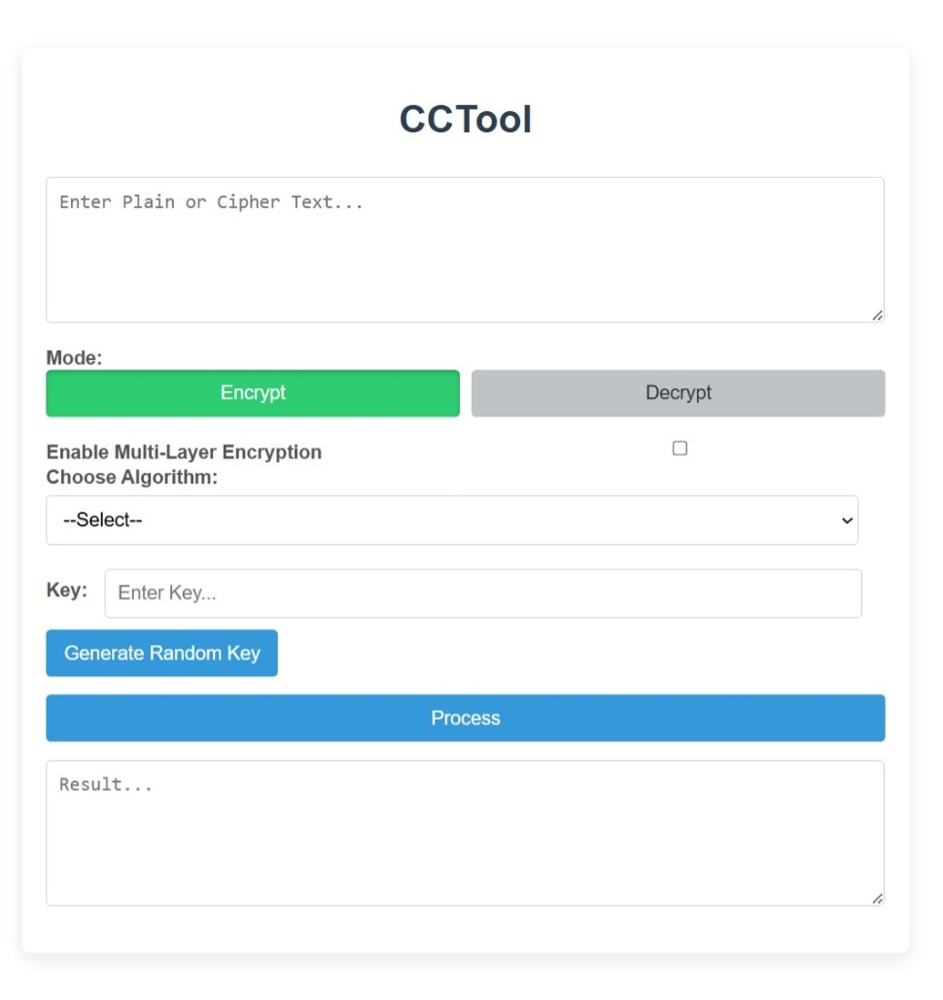

# CCTool: Classical Cryptography Toolkit

## Implemented Algorithms
- Caesar Cipher
- Monoalphabetic Cipher
- Railfence Cipher
- Row column Transposition Cipher
- Vignere Cipher
- Playfair Cipher

# Visible Preview

## Side Note
- This code base is incomplete and has been altered using AI agents. 
- This code is workable, execution of the functions is possible. 
- All algorithms are able to work with multi-layer encryption as well.